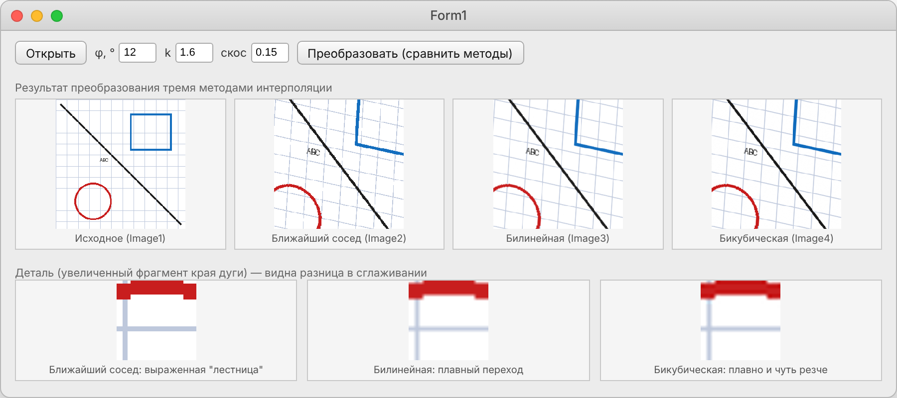

# Лабораторная работа №8. Интерполяция изображений

**Дисциплина:** Компьютерная графика
**Среда разработки:** Lazarus IDE (Free Pascal Compiler)
**Задание:** выполнить аффинные преобразования масштабирования, поворота и скоса с разными параметрами, применяя разные методы интерполяции (по вариантам отдельного деления на варианты задание не предусматривает – единая формулировка для всех).

## Постановка задачи

Разработать программу, выполняющую аффинные преобразования изображения (масштабирование, поворот, скос) методом обратного отображения, и для каждого преобразованного пикселя вычисляющую цвет тремя разными методами интерполяции:

1. **Интерполяция по ближайшему соседу** – `g(x,y) = f(round(x), round(y))`.
2. **Билинейная интерполяция** – по 4 ближайшим пикселям: `g(x,y) = (1-a)(1-b)f(l,k) + a(1-b)f(l+1,k) + b(1-a)f(l,k+1) + ab·f(l+1,k+1)`, где `l=floor(x)`, `k=floor(y)`, `a=x-l`, `b=y-k`.
3. **Бикубическая интерполяция** – по 16 пикселям (окно 4×4), полином шестой степени; реализована как раздельное произведение кубических весов Лагранжа по осям X и Y (математически эквивалентно формуле из методички, но без накопления ошибки округления коэффициентов).

Сделать выводы о различиях между методами.

## Инструменты

- Free Pascal Compiler (FPC)
- Lazarus IDE
- Компоненты LCL: `TImage`, `TBitmap`, `Canvas`

## Решение

Форма содержит:

| Компонент | Имя | Назначение |
|---|---|---|
| TImage | `Image1` | исходное изображение |
| TImage | `Image2` | результат – интерполяция по ближайшему соседу |
| TImage | `Image3` | результат – билинейная интерполяция |
| TImage | `Image4` | результат – бикубическая интерполяция |
| TButton | `ButtonLoad` | "Открыть" |
| TEdit | `EditAngle` | угол поворота φ, градусы |
| TEdit | `EditScale` | коэффициент масштабирования k |
| TEdit | `EditSkew` | коэффициент скоса по оси X |
| TButton | `ButtonTransform` | "Преобразовать (сравнить методы)" |
| TButton | `ButtonSaveNearest`, `ButtonSaveBilinear`, `ButtonSaveBicubic` | сохранение соответствующих результатов |

Преобразование реализовано **методом обратного отображения**: для каждого пикселя результата координаты переводятся обратно в систему координат исходного изображения (сначала отменяется поворот, затем скос, затем масштаб), после чего цвет в полученной вещественной точке источника вычисляется выбранным методом интерполяции.

Код приложения находится в файле [`Unit1.pas`](Unit1.pas).

Логика работы:
- **Кнопка «Открыть»** – загружает исходное изображение
- **Кнопка «Преобразовать (сравнить методы)»** – применяет к изображению одно и то же аффинное преобразование (поворот на φ, масштаб k, скос) и показывает результат сразу всеми тремя методами интерполяции (`SampleNearest`, `SampleBilinear`, `SampleBicubic`) для наглядного сравнения
- **Кнопки «Сохранить»** – сохраняют результат соответствующего метода в файл

## Демонстрация работы

**Результат преобразования тремя методами интерполяции**

Исходное изображение (сетка + фигуры для наглядности); результат одного и того же преобразования (поворот 12°, масштаб 1.6, скос 0.15) тремя методами. На увеличенном фрагменте края дуги хорошо видно: у метода ближайшего соседа граница получается выраженной «лестницей» из крупных блоков одного цвета; билинейная интерполяция сглаживает переход, но слегка размывает границу; бикубическая интерполяция даёт столь же плавный, но немного более резкий (контрастный) переход за счёт учёта более широкого окна пикселей.

## Как запустить

1. Создать новый проект Application в Lazarus.
2. Разместить на форме компоненты по таблице выше с точными именами.
3. Вставить код `Unit1.pas` целиком, привязать `OnClick` каждой кнопки.
4. На macOS при ошибке линковщика `ld: malformed method list atom` добавить `-WM10.9` в Project Options → Compiler Options → Custom Options.
5. Запустить: "Открыть" → ввести φ, k, скос → "Преобразовать (сравнить методы)".

## Вывод

Интерполяция по ближайшему соседу – самый быстрый, но и самый грубый метод: границы объектов получаются ступенчатыми, особенно заметно при увеличении изображения. Билинейная интерполяция, учитывающая 4 соседних пикселя, даёт визуально гладкий результат ценой лёгкого размытия резких границ. Бикубическая интерполяция, учитывающая более широкое окно (16 пикселей) и полином более высокой степени, обеспечивает лучшее сохранение резкости границ при той же гладкости, но требует заметно больше вычислений на каждый пиксель результата (16 обращений к исходному изображению на канал против 4 у билинейной и 1 у метода ближайшего соседа).
